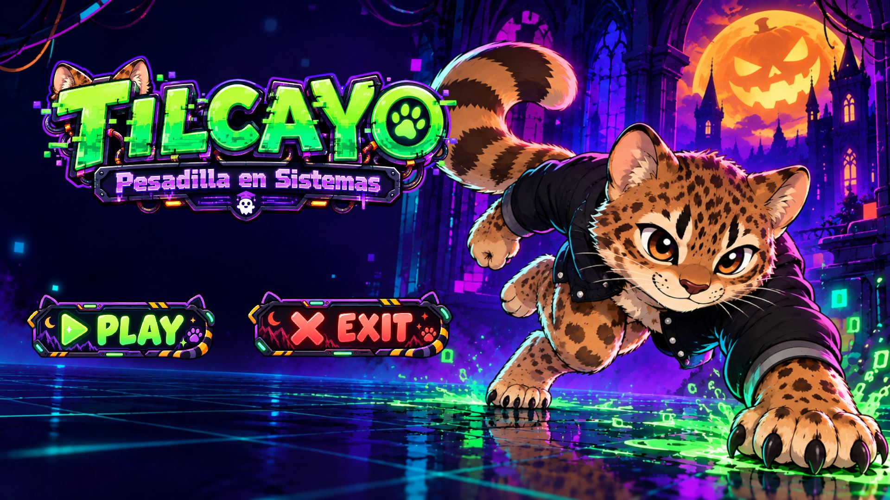
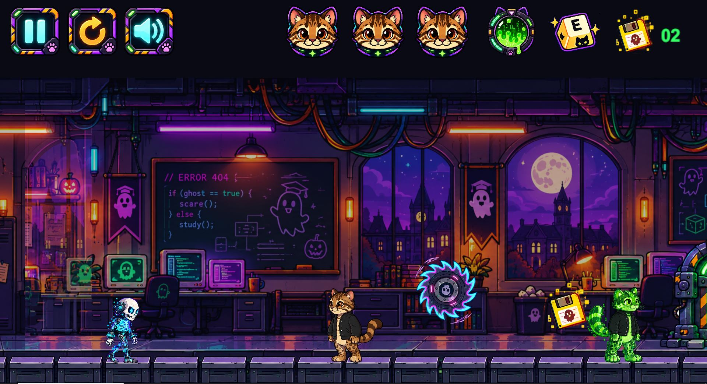

# Eduardo Gabriel Viscarra Quisbert

### Desarrollador de Videojuegos en Unity (2D / 3D) & Game Designer

 

Desarrollador de videojuegos en **Unity (2D y 3D)** apasionado por crear experiencias completas desde su concepción hasta su implementación. Me encanta estructurar **Game Design Documents (GDD)** y diseñar las **mecánicas de juego junto con las storylines (narrativa)** para que la jugabilidad y la historia avancen de la mano. Le pongo el máximo empeño y dedicación a cada proyecto, disfrutando especialmente del trabajo en equipo para construir juegos pulidos, inmersivos y bien organizados.

---

## Stack Técnico y Especialidades

* **Game Design, Mecánicas y Narrativa (Storylines):** Creación de *Game Design Documents (GDD)* detallados, diseño de niveles, conceptualización de mecánicas originales integradas con la historia, narrativa ramificada con múltiples finales y trabajo colaborativo en equipo.
* **Arquitectura de Gameplay en Unity (2D y 3D):** Programación en C# de sistemas de juego, máquinas de estados para jefes y niveles, gestión de progreso y coleccionables, sistemas de interacción con el entorno (puertas bidireccionales por *Triggers* y corrutinas, terminales de checkpoint) y comunicación limpia entre Gameplay, UI y Audio ambiental.
* **Control de Personaje, Físicas y Cámaras (2D / 3D):**
  * **Entornos 3D:** Movimiento con `CharacterController` y gravedad, transición dinámica de cámaras en 1ra y 3ra persona con **Cinemachine**, mezcla de animaciones con **Blend Trees** (`Animator`) y soporte multiplataforma con **Unity Input System** (Teclado/Mouse, Gamepad y controles táctiles móviles).
  * **Entornos 2D:** Controladores de plataformeo y combate con `Rigidbody2D`, detección de colisiones precisa (`OverlapCircleAll` / `OverlapBox`), mecánicas de teletransporte y animación procedural (*Squash & Stretch* y oscilación de títeres).

---

## Proyectos Destacados

### 1. [Un Cuento Más](https://github.com/Gabosito1314/UnCuentoMas) — *2D Puppet Theater Action & Narrative Game (Unity 6)*

 

  

Juego 2D de acción y narrativa ramificada ambientado en un teatro de títeres medieval donde cada personaje, jefe, cartel y elemento de HUD cuelga de varillas e hilos animados por código, culminando en una decisión moral con **2 finales jugables**.

* **Sistemas y Mecánicas Programadas (Enlaces directos al código C#):**
  * [**`DragonBossController.cs`**](https://github.com/Gabosito1314/UnCuentoMas/blob/main/Assets/_Project/Scripts/Combat/DragonBossController.cs): Combate de jefe multifase (Fase Aérea con varilla desde el techo + anulación de proyectiles, Fase Terrestre con varilla desde el piso y Fase de Revelación).
  * [**`PlayerMagoController.cs`**](https://github.com/Gabosito1314/UnCuentoMas/blob/main/Assets/_Project/Scripts/Player/PlayerMagoController.cs): Movimiento con *Squash & Stretch*, giro de recorte de cartón, *Dash* evasivo ("Giro de Papel") y hechizos rectos/diagonales cargados.
  * [**`StoryAndEndingManager.cs`**](https://github.com/Gabosito1314/UnCuentoMas/blob/main/Assets/_Project/Scripts/Narrative/StoryAndEndingManager.cs): Orquestador de la storyline en 5 actos, tutorial interactivo, cinemática de *flashback* teatral y 2 desenlaces jugables.
  * [**`CurtainStageManager.cs`**](https://github.com/Gabosito1314/UnCuentoMas/blob/main/Assets/_Project/Scripts/Core/CurtainStageManager.cs) y [**`PuppetWobble.cs`**](https://github.com/Gabosito1314/UnCuentoMas/blob/main/Assets/_Project/Scripts/Core/PuppetWobble.cs): Sistema de transiciones con telón de teatro y animación de varillas e hilos.
* [**Ver Repositorio y Documentación**](https://github.com/Gabosito1314/UnCuentoMas) · [**Jugar en Itch.io**](https://eduardoviscarra.itch.io/un-cuento-mas) · [**Descargar Build (GitHub Releases)**](https://github.com/Gabosito1314/UnCuentoMas/releases)

---

### 2. [Tilcayo: Pesadilla en Sistemas](https://github.com/Gabosito1314/Tilcayo_GameJam) — *2D Cyberpunk-Halloween Precision Platformer (Unity 6)*

 

  

Plataformero 2D de acción y precisión desarrollado en equipo para Game Jam en Unity 6 (con **Game Design Document** completo incluido en el repositorio). El jugador controla a **Tilcayo**, quien utiliza una habilidad de **clonación y teletransporte de código líquido (`Slime TP`)** para atravesar sierras, trampas y derrotar al jefe corrupto del servidor.

* **Sistemas y Mecánicas Programadas (Enlaces directos al código C#):**
  * [**`GDD_Tilcayo_Pesadilla_en_Sistemas.docx`**](https://github.com/Gabosito1314/Tilcayo_GameJam/blob/main/GDD_Tilcayo_Pesadilla_en_Sistemas.docx): Documento de Diseño de Juego (GDD) con la historia, mecánicas, diseño de niveles y enemigos.
  * [**`SlimeTPAbility.cs`**](https://github.com/Gabosito1314/Tilcayo_GameJam/blob/main/Assets/_Project/Scripts/Player/SlimeTPAbility.cs) y [**`CodeOozeCrawler.cs`**](https://github.com/Gabosito1314/Tilcayo_GameJam/blob/main/Assets/_Project/Scripts/Player/CodeOozeCrawler.cs): Mecánica insignia en 2 pulsaciones con clon en capa física dedicada (`CloneSlime`) y validación *Anti-Stuck* (`OverlapBox`).
  * [**`GameEvents.cs`**](https://github.com/Gabosito1314/Tilcayo_GameJam/blob/main/Assets/_Project/Scripts/Core/GameEvents.cs) y [**`GameManager.cs`**](https://github.com/Gabosito1314/Tilcayo_GameJam/blob/main/Assets/_Project/Scripts/Core/GameManager.cs): Sistema de eventos para conectar el HUD, el audio, los checkpoints y el respawn.
  * [**`TilcayoController.cs`**](https://github.com/Gabosito1314/Tilcayo_GameJam/blob/main/Assets/_Project/Scripts/Player/TilcayoController.cs): Controlador modular de movimiento, salud, estados de animación y combate.
* [**Ver Repositorio y Documentación**](https://github.com/Gabosito1314/Tilcayo_GameJam) · [**Jugar en Itch.io**](https://eduardoviscarra.itch.io/tilcayo-pesadilla-en-sistemas) · [**Descargar Build (GitHub Releases)**](https://github.com/Gabosito1314/Tilcayo_GameJam/releases)
