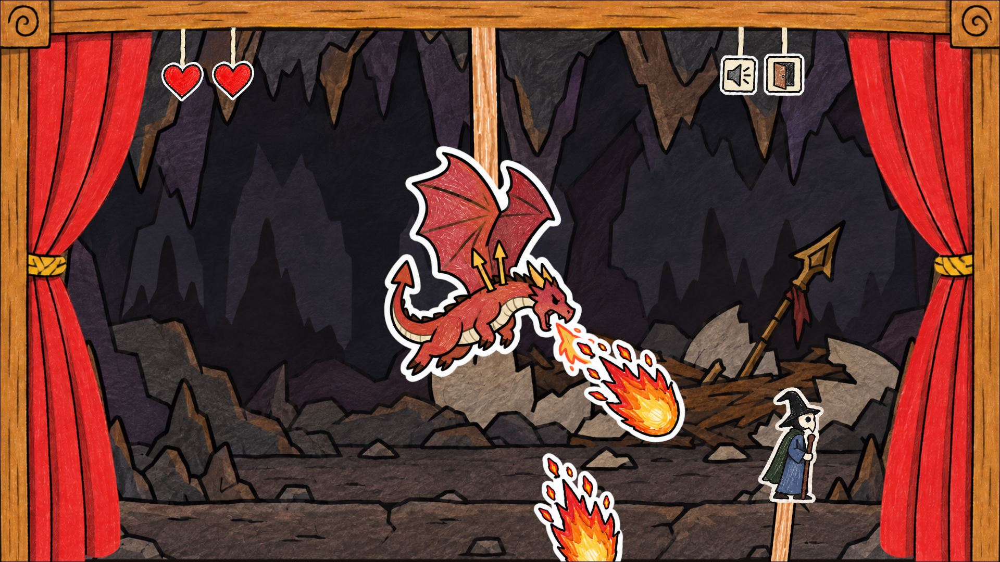
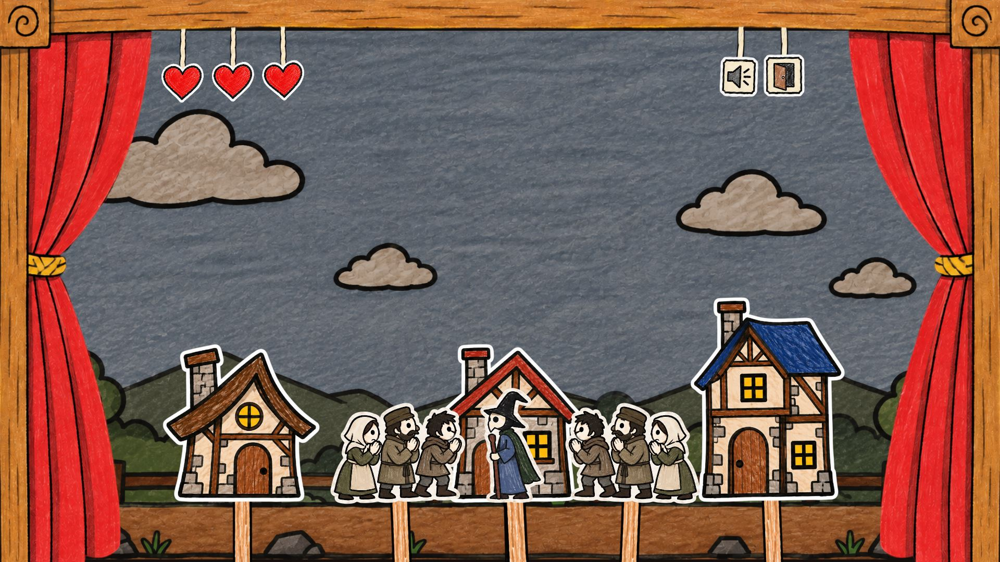

# 👋 Hola, soy Gabriel Viscarra (`@Gabosito1314`)

### 🎮 Unity / C# Gameplay & Systems Programmer

Soy desarrollador de videojuegos enfocado en **programación de gameplay, arquitectura de sistemas desacoplados, máquinas de estados (FSM), físicas 2D y creación de herramientas de automatización para el Editor de Unity (`UnityEditor`)**. Me apasiona construir mecánicas que se sientan precisas y expresivas en pantalla manteniendo un código modular, limpio y fácil de escalar en equipo.

---

## 🛠️ Stack Técnico & Especialidades

-000000?style=for-the-badge&logo=unity&logoColor=white)

* **Arquitectura de Gameplay:** Patrones *Observer / Event Bus*, *Finite State Machines (FSM)* multifase, separación de responsabilidades (*SRP*) y comunicación desacoplada entre Gameplay, UI y Audio.
* **Físicas 2D & Feel de Combate:** Controladores de personaje 2D con interpolación física, detección de colisión dual anti-*tunneling* (`Rigidbody2D` + `Physics2D.OverlapCircleAll` / `OverlapBox`), animación procedural (*Squash & Stretch*, oscilación sinusoidal) y cámaras 2D con amortiguación.
* **Tooling de Editor (`UnityEditor`):** Generadores automáticos de escenas, sincronizadores de *Sorting Layers*, pipelines de *slicing* de sprites, ensamblaje de `AnimatorController` y validación con `[InitializeOnLoad]` y `[MenuItem]`.

---

## 🏆 Proyectos Destacados de Videojuegos

### 1. 🎭 [Un Cuento Más](https://github.com/Gabosito1314/UnCuentoMas) — *2D Puppet Theater Action & Narrative Game (Unity 6)*

  

Juego 2D de acción y narrativa ramificada ambientado en un teatro de títeres medieval donde cada personaje, jefe, cartel y elemento de HUD cuelga de varillas e hilos animados por código, culminando en una decisión moral con **2 finales jugables**.

* **Sistemas Clave Programados (Enlaces directos al código C#):**
  * 🐉 [**`DragonBossController.cs`**](https://github.com/Gabosito1314/UnCuentoMas/blob/main/Assets/_Project/Scripts/Combat/DragonBossController.cs): Máquina de estados de jefe multifase (Fase Aérea con varilla desde el techo + anulación de proyectiles, Fase Terrestre con varilla desde el piso y Fase de Revelación).
  * 🧙‍♂️ [**`PlayerMagoController.cs`**](https://github.com/Gabosito1314/UnCuentoMas/blob/main/Assets/_Project/Scripts/Player/PlayerMagoController.cs): Movimiento con *Squash & Stretch*, giro de recorte de cartón, *Dash* evasivo ("Giro de Papel") y hechizos rectos/diagonales cargados con detección de colisión doble.
  * 📖 [**`StoryAndEndingManager.cs`**](https://github.com/Gabosito1314/UnCuentoMas/blob/main/Assets/_Project/Scripts/Narrative/StoryAndEndingManager.cs): Orquestador narrativo de 5 actos, tutorial guiado por eventos (14 estados), cinemática de *flashback* teatral y 2 desenlaces jugables.
  * 🛠️ [**`TheaterSceneBuilderEditor.cs`**](https://github.com/Gabosito1314/UnCuentoMas/blob/main/Assets/_Project/Scripts/Editor/TheaterSceneBuilderEditor.cs): Herramienta `UnityEditor` para construir y sincronizar automáticamente las 6 escenas y órdenes de capa del proyecto.
* 🔗 [**Ver Repositorio y Documentación Técnica**](https://github.com/Gabosito1314/UnCuentoMas) · 🎮 [**Descargar Build Jugable (Releases)**](https://github.com/Gabosito1314/UnCuentoMas/releases)

---

### 2. 🐾 [Tilcayo: Pesadilla en Sistemas](https://github.com/Gabosito1314/Tilcayo_GameJam) — *2D Cyberpunk-Halloween Precision Platformer (Unity 6)*

  

Plataformero 2D de acción y precisión desarrollado para Game Jam en Unity 6. El jugador controla a **Tilcayo**, quien utiliza una habilidad de **clonación y teletransporte de código líquido (`Slime TP`)** para atravesar sierras, trampas y derrotar al jefe corrupto del servidor.

* **Sistemas Clave Programados (Enlaces directos al código C#):**
  * 🧪 [**`SlimeTPAbility.cs`**](https://github.com/Gabosito1314/Tilcayo_GameJam/blob/main/Assets/_Project/Scripts/Player/SlimeTPAbility.cs) & [**`CodeOozeCrawler.cs`**](https://github.com/Gabosito1314/Tilcayo_GameJam/blob/main/Assets/_Project/Scripts/Player/CodeOozeCrawler.cs): Mecánica insignia en 2 pulsaciones con proyectil en capa física dedicada (`CloneSlime`) y validación espacial *Anti-Stuck* mediante `Physics2D.OverlapBox`.
  * ⚡ [**`GameEvents.cs`**](https://github.com/Gabosito1314/Tilcayo_GameJam/blob/main/Assets/_Project/Scripts/Core/GameEvents.cs) & [**`GameManager.cs`**](https://github.com/Gabosito1314/Tilcayo_GameJam/blob/main/Assets/_Project/Scripts/Core/GameManager.cs): Bus de eventos estático para desacoplar al 100% el HUD, el audio, los checkpoints y el sistema de salud/respawn.
  * 🐾 [**`TilcayoController.cs`**](https://github.com/Gabosito1314/Tilcayo_GameJam/blob/main/Assets/_Project/Scripts/Player/TilcayoController.cs): Arquitectura modular de jugador (`PlayerMovement2D`, `PlayerHealth`, `PlayerInputReader`) optimizada con hashes precalculados `Animator.StringToHash`.
  * 🛠️ [**`ProjectSetupTools.cs`**](https://github.com/Gabosito1314/Tilcayo_GameJam/blob/main/Assets/_Project/Scripts/Editor/ProjectSetupTools.cs): Pipeline de automatización en `UnityEditor` para configuración de layers, matriz de colisiones 2D, *slicing* de sprites, animaciones y escenas.
* 🔗 [**Ver Repositorio y Documentación Técnica**](https://github.com/Gabosito1314/Tilcayo_GameJam) · 🎮 [**Descargar Build Jugable (Releases)**](https://github.com/Gabosito1314/Tilcayo_GameJam/releases)
